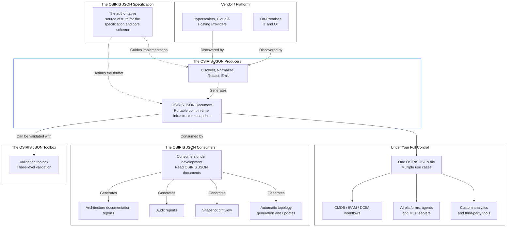

# The OSIRIS JSON Producers

[](https://github.com/osirisjson/osiris-producers/blob/main/LICENSE)
[](https://pkg.go.dev/go.osirisjson.org/producers)
[](https://github.com/osirisjson/osiris-producers/releases/latest)
[](https://github.com/osirisjson/osiris-producers/releases)
[](https://docs.osirisjson.org/osiris-producers/getting-started/)
[](https://sonarcloud.io/component_measures?metric=security_rating&id=osirisjson_osiris-producers)

An **OSIRIS JSON Producer** is a lightweight, **read-only**
infrastructure discovery software written in Go that **transforms**
proprietary, vendor-specific infrastructure data into **portable, vendor-neutral [OSIRIS JSON](https://github.com/osirisjson/osiris)** snapshots
documents.

It connects to supported public platforms and private on-premises
environments, discovers resources and their relationships, normalizes
vendor-specific data, applies sensitive-data redaction and generates a
structured representation of the infrastructure at a specific point in
time.

**OSIRIS JSON Producers run under your control, without requiring proprietary intermediary platforms, separate SaaS services, external consultancy, or AI integration.**

<p align="center">
  
  <br />
  <sub><em>OSIRIS JSON Cisco APIC Producer generating a vendor-neutral OSIRIS JSON infrastructure snapshot using the Cisco DevNet always-on ACI simulator.</em></sub>
</p>

## Installation

OSIRIS JSON Producers are available as pre-built binaries for
**Linux, macOS, and Windows**. See [INSTALL](INSTALL.md) for more
informations.

| OS | Quick install |
|---|---|
| **Linux** | Download the `.deb` or `.rpm` package from [GitHub Releases](https://github.com/osirisjson/osiris-producers/releases), then install using `sudo apt install` or `sudo dnf install` or `sudo zypper install`. |
| **macOS** | `brew tap osirisjson/osiris-producers && brew install osirisjson-producer` |
| **Windows** | `winget install osirisjson.osirisjson-producer` |

**Verify your installation:**

```bash
osirisjson-producer --version
```

For alternative installation methods (Scoop, manual archives, Go),
supported architectures, checksum verification, and troubleshooting,
see [INSTALL.md](INSTALL.md).
Once installed, follow the [Getting Started Guide](https://docs.osirisjson.org/osiris-producers/getting-started/) to generate your first OSIRIS JSON
snapshot.


### Try the OSIRIS JSON Cisco APIC Producer on Cisco DevNet

The demo above was conducted on [Cisco ACI Simulator Always On](https://developer.cisco.com/sandbox/detail/aci-simulator-always-on) sandbox.

```bash
# Show available Cisco APIC options
osirisjson-producer cisco apic --help

# Discover infrastructure from the Cisco DevNet sandbox
# --insecure is used for the sandbox's self-signed certificate.
# Use trusted certificate verification in production.
osirisjson-producer cisco apic -h sandboxapicdc.cisco.com --insecure

# Generate an audit-purpose snapshot
osirisjson-producer cisco apic -h sandboxapicdc.cisco.com --insecure --purpose audit
```

## Supported IT infrastructure environments

| OSIRIS JSON Producer | Category | Status |
|---|---|---|
| **Amazon AWS** | Hyperscaler | [Available](https://docs.osirisjson.org/osiris-producers/hyperscalers/amazon-aws/) |
| **Cloudflare** | Hyperscaler | Planned |
| **Google Cloud** | Hyperscaler | [Under development](https://osirisjson.org/en/commitments/roadmap) |
| **Microsoft Azure** | Hyperscaler | [Available](https://docs.osirisjson.org/osiris-producers/hyperscalers/microsoft-azure/) |
| **Arista EOS** | Network | Planned |
| **Ciena SAOS** | Network | Planned |
| **Cisco (APIC, NX-OS, IOS-XE, Catalyst SD-WAN Manager)** | Network | [Available](https://docs.osirisjson.org/osiris-producers/network/cisco) |
| **F5 BIG-IP** | Network | Planned |
| **HPE Aruba Networking Central** | Network | [Available](https://docs.osirisjson.org/osiris-producers/network/hpe-aruba-networking-central) |
| **HPE Aruba AOS** | Network | Planned |
| **MikroTik RouterOS** | Network | Planned |
| **Nokia SR** | Network | Planned |
| **SONiC** | Network | Planned |
| **Ubiquiti UniFi (ui.com)** | Network | Planned |
| **Check Point** | Security | Planned |
| **Palo Alto** | Security | Planned |
| **Proxmox VE** | Hypervisor | Planned |
| **VMware vSphere** | Hypervisor | Planned |

## Supported OT infrastructure environments

| OSIRIS JSON Producer | Category | Status |
|---|---|---|
| **Zebra PPME LinkOS** | Industrial Printers | Planned |

*For the complete roadmap, visit [osirisjson.org/en/commitments/roadmap](https://osirisjson.org/en/commitments/roadmap).*

---

## The OSIRIS JSON Manifesto in practice

End-to-end infrastructure visibility should not depend on tribal
knowledge, expensive consultancy, or closed, proprietary platforms.

With OSIRIS JSON:

- **Your infrastructure knowledge belongs to you without paying any fees.**
- **One portable, vendor-neutral snapshot. Multiple use cases.**
- **Automation first. AI when needed.**
- No AI platform, MCP server, or external agent is required.
- No additional SaaS subscription or hosted intermediary is required by OSIRIS.
- OSIRIS JSON Producers operate within an environment you control.
- Credentials and authentication secrets are excluded from generated documents.
- Operational logs provide visibility into discovery, normalization, redaction, validation and emission.

*Generated OSIRIS JSON documents remain local by default, unless explicitly configured for another destination. **You decide how they are used.***

[Read the OSIRIS JSON Manifesto](https://osirisjson.org/en/commitments/manifesto)

---

## Architecture workflow



## Security

OSIRIS JSON Producers are designed to exclude credentials and
authentication secrets from generated OSIRIS JSON documents.
Snapshots may still contain sensitive infrastructure information,
including internal addresses, resource identifiers, network topology and 
asset names. Review generated documents before sharing them publicly.

Additional security resources:
- [The OSIRIS JSON Security Policy](https://osirisjson.org/en/commitments/security)
- [SECURITY.md](SECURITY.md)

## Documentation and contribution

- [OSIRIS JSON Producer Development Guidelines](https://docs.osirisjson.org/developer-guidelines/producers/producer-guidelines/)
- [Community & contribution guidelines](https://docs.osirisjson.org/community/contributing/)